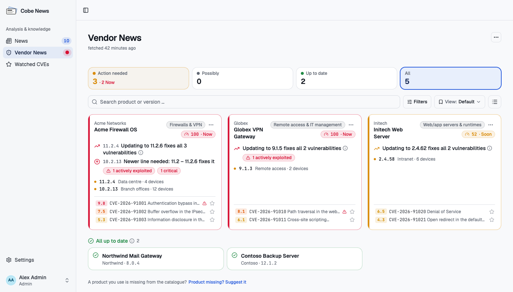
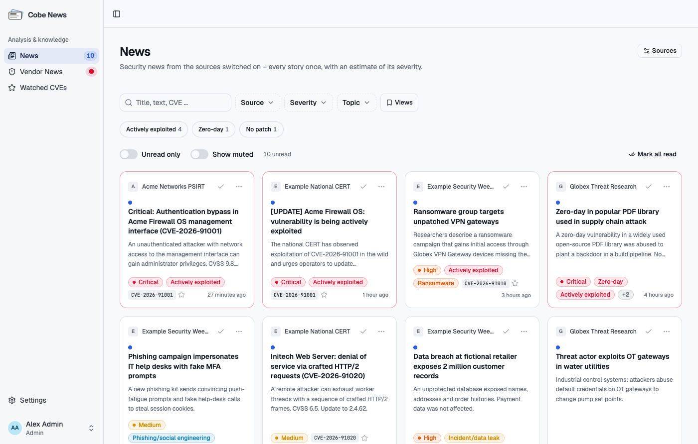

# Cobe News

**Security-Nachrichten und Hersteller-Advisories, selbst betrieben – abgeglichen mit den Produkten und Versionen, die
ihr wirklich einsetzt.**

[](https://github.com/G0urmetD/Cobe-News/pkgs/container/cobe-news)

> **English:** Cobe News is a self-hosted tool for security teams: it collects security news from CERTs, vendors and
> the trade press, checks vendor advisories against the exact products and versions you run, and notifies the people
> responsible. The user interface and the built-in handbook are available in German and English; this README and the
> operations reference [`docs/BETRIEB.md`](docs/BETRIEB.md) are in German. The English handbook lives in
> [`docs/handbuch/en/`](docs/handbuch/en/) and in the app under *Documentation*.

Cobe News ist ein selbst betriebenes Werkzeug für Security-Teams. Es sammelt Security-Nachrichten von BSI, CISA,
Herstellern und Fachpresse, prüft Hersteller-Advisories gegen eure genauen Produkte und Versionen, bewertet die
Dringlichkeit mit CISA KEV und EPSS und benachrichtigt Teams und Personen per E-Mail, Microsoft Teams, Push oder Webhook.



## Funktionen

- **News** – 46 eingebaute Feeds (CERTs und Behörden, Hersteller-PSIRTs, Fachpresse, Research, KEV-/EUVD-Kataloge),
  jede Meldung nur einmal, mit Schwere, Themen (ausgenutzt, Zero-Day, Ransomware …) und CVEs; eigene Feeds lassen sich
  ergänzen.
- **Vendor News** – Produkten aus einem kuratierten Katalog oder per CPE folgen, die installierten Versionen eintragen
  und genau sehen, welche Schwachstellen sie betreffen, welche Version sie behebt und wann der Support endet.
- **Dringlichkeit** – Befunde nach CVSS, CISA KEV und FIRST EPSS geordnet, aktiv ausgenutzte Lücken zuerst.
- **Beobachtete CVEs** – einzelnen CVEs folgen und benachrichtigt werden, wenn ein Fix erscheint, sie in CISA KEV
  landen oder ihr EPSS-Wert springt.
- **Teams und Zuständigkeit** – Teams aus AD- oder Entra-ID-Gruppen, Produkte je Team, Benachrichtigungen an die
  Zuständigen.
- **Benachrichtigungen** – E-Mail, Microsoft Teams, Slack, Discord, Mattermost, Telegram, ntfy, Gotify, signierte
  generische Webhooks und Desktop-Push, mit Regeln nach Schwere, Quelle und Team.
- **Anmeldung** – lokale Konten, Active Directory (LDAP) und Entra ID (OIDC), mit TOTP und Passkeys.
- **Betrieb** – Protokoll (Audit-Log), lesende REST-API und Prometheus-Metriken, verschlüsselte Sicherungen mit
  automatischem Rücksicherungs-Test, HTTPS ab Werk.
- Oberfläche auf **Deutsch und Englisch**, helles und dunkles Design, eingebautes Handbuch.



## Schnellstart

Voraussetzung: Docker mit Docker Compose v2.

```bash
git clone https://github.com/G0urmetD/Cobe-News.git cobe-news
cd cobe-news
scripts/setup-env.sh              # legt .env mit erzeugten Datenbank-Passwörtern an; unter Linux bekommt die App data/ (UID 10001)
docker compose up -d --build      # App, PostgreSQL 18 und nginx (HTTPS)
docker compose logs app | grep -A1 "Setup token"
```

Unter Linux als Benutzer ohne sudo-Rechte gibt das Skript stattdessen den einen nötigen Befehl aus
(`sudo chown -R 10001:10001 data`).

**<https://localhost:8095>** öffnen (das selbstsignierte Zertifikat löst beim ersten Aufruf eine Browser-Warnung aus),
das einmalige Setup-Token aus dem Log eingeben (60 Minuten gültig) und das erste Admin-Konto mit einer
Authenticator-App (TOTP) anlegen. Danach die Quellen unter *Einstellungen → Integrationen → News* einschalten und unter
*Vendor News* den eigenen Produkten folgen.

Ab Werk lauscht die App nur auf diesem Rechner. Adresse, Port, Zertifikat, Reverse Proxy und ausgehender Proxy werden in
`.env` gesetzt – siehe [`.env.example`](.env.example). Hinter einem eigenen Reverse Proxy auf demselben Host (nginx,
Traefik …) ist `PROXY_ENABLED=0` der einzige Schalter – den Proxy auf `http://127.0.0.1:8096` zeigen lassen
([`docs/BETRIEB.md`](docs/BETRIEB.md#https), Abschnitt 3).

Drei Container, alle lokal gebaut: die App, die Datenbank (PostgreSQL 18, das bei jedem Start die eigene Rolle der App
einrichtet) und der Proxy (nginx). Statt zu bauen, lassen sich die veröffentlichten, signierten Images
`ghcr.io/g0urmetd/cobe-news`, `…/cobe-news-db` und `…/cobe-news-proxy` betreiben: in `.env`
`COMPOSE_FILE=docker-compose.yml:docker-compose.image.yml` und `COBE_NEWS_VERSION=<Version>` setzen, dann
`docker compose pull && docker compose up -d` – wie man die Signaturen mit cosign prüft:
[`docs/BETRIEB.md`](docs/BETRIEB.md#veröffentlichtes-image-statt-lokalem-build). Ohne diese beiden Zeilen ändert sich
nichts.

Mit Portainer (ohne Checkout): [`docker-compose.portainer.yml`](docker-compose.portainer.yml) in den Web-Editor des
Stacks einfügen und einen der beiden Blöcke mit Umgebungsvariablen oben in der Datei eintragen (mit oder ohne eigenen
Reverse Proxy: Passwörter, `BASE_URL` und ein Schalter) – siehe [`docs/BETRIEB.md`](docs/BETRIEB.md#portainer-stack-editor).

## Dokumentation

- **Handbuch in der App** – Benutzermenü → *Dokumentation* (`/docs`), Deutsch und Englisch: Einrichtung, Anmeldung,
  Kanäle und Regeln, Vendor News, Sicherungen, API und FAQ. Die Quelle liegt in [`docs/handbuch/`](docs/handbuch/README.md).
- **Betriebs-Referenz** – [`docs/BETRIEB.md`](docs/BETRIEB.md): Konfiguration, HTTPS, Netz, PostgreSQL, Sicherung und
  Wiederherstellung, Katalogpflege, Entwicklung und Tests.
- **Befunde von Image-Scannern** – [`docs/SICHERHEIT-SCANS.md`](docs/SICHERHEIT-SCANS.md): was die Prüfung im Release
  zusichert, warum Befunde ohne Korrektur bleiben, wie man selbst scannt (`scripts/scan-images.sh`).
- **Änderungen** – [`CHANGELOG.md`](CHANGELOG.md).

## Sicherheit

Schwachstellen bitte nicht in öffentlichen Issues melden, sondern vertraulich über
[GitHub Security Advisories](https://github.com/G0urmetD/Cobe-News/security/advisories/new) dieses Repositorys.

## Lizenz

[MIT](LICENSE)
